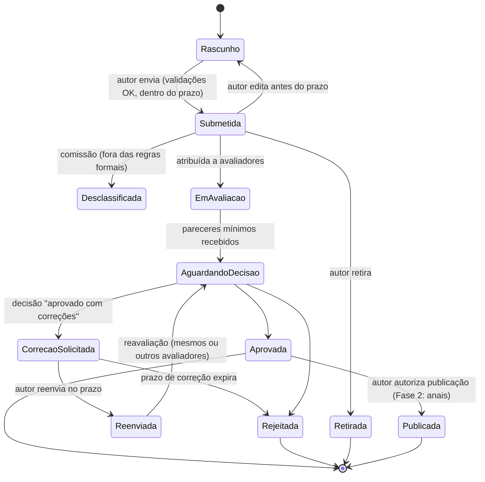
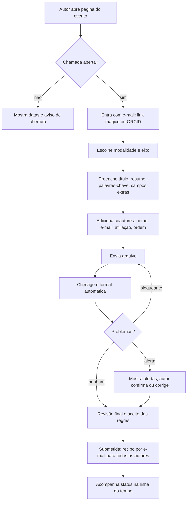
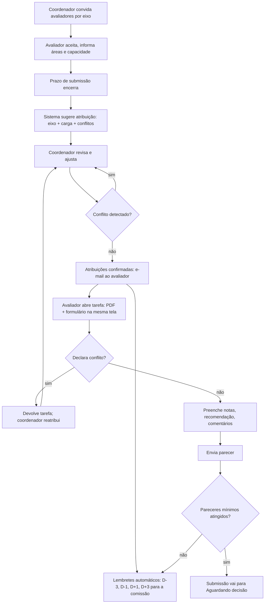
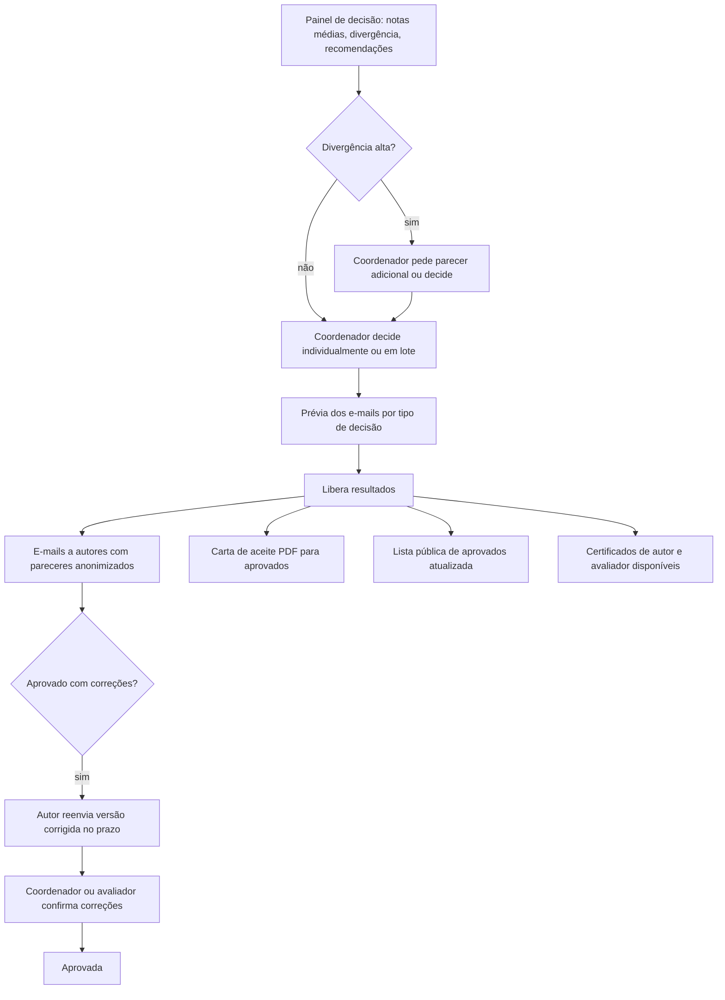
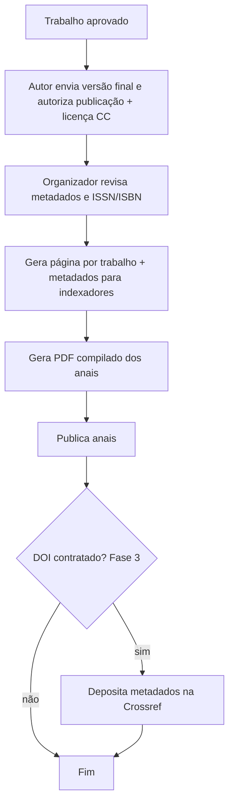

# 6 e 8. Jornadas, fluxogramas, telas e dashboards

Diagramas em Mermaid (renderizam no GitHub e no VS Code com extensão).

## 6.1 Máquina de estados da submissão



Regra: a decisão só é comunicada ao autor quando a comissão **libera os resultados** (em lote ou individualmente). Antes disso, o autor vê "Em avaliação".

## 6.2 Jornada de submissão (autor)



Meta de UX: **até 4 telas** do login à submissão, salvando rascunho a cada passo.

## 6.3 Jornada de avaliação (comissão e avaliador)



## 6.4 Jornada de decisão e divulgação



## 6.5 Jornada de publicação (Fase 2)



## 6.6 Jornadas por perfil

| Perfil | Jornada principal | Frequência | Dispositivo provável |
|---|---|---|---|
| Admin da plataforma | Criar organização, acompanhar uso, apoiar suporte | Diária | Desktop |
| Organizador | Criar evento, configurar chamada, acompanhar números, comunicar | Semanal, intensa em picos | Desktop |
| Coordenador científico | Convidar avaliadores, atribuir, decidir | Intensa em 2 a 4 semanas | Desktop |
| Avaliador | Aceitar convite, avaliar 3 a 15 trabalhos | Pontual | Desktop (leitura de PDF); celular para aceite e lembrete |
| Autor | Submeter, acompanhar, corrigir, baixar carta e certificado | Pontual | Celular e desktop |
| Participante (Fase 2) | Inscrever-se, ver programação, baixar certificado | Pontual | Celular |
| Visitante | Ver evento, aprovados, anais, validar certificado | Pontual | Celular |

## 8. Estrutura de telas e dashboards

### 8.1 Mapa de telas do MVP

```
Público
├── /<org>/<evento>                 Página do evento (sobre, datas, chamada, contato)
├── /<org>/<evento>/aprovados       Lista de trabalhos aprovados
└── /validar/<codigo>               Validação de certificado

Conta
├── /entrar                         E-mail (link mágico) ou senha
├── /perfil                         Dados pessoais, instituição, ORCID, Lattes, áreas
└── /minha-area                     Todas as minhas submissões, avaliações e certificados

Autor
├── /e/<evento>/submeter            Wizard de 4 passos
└── /e/<evento>/submissoes/<id>     Status, linha do tempo, pareceres, correção, carta

Avaliador
├── /avaliacoes                     Lista de tarefas com prazo
└── /avaliacoes/<id>                PDF à esquerda, formulário à direita (empilhado no celular)

Organização / Comissão
├── /org/<org>                      Eventos da organização
├── /org/<org>/eventos/novo         Assistente: modelo ou clonar edição
└── /org/<org>/eventos/<id>/
    ├── painel                      Dashboard do evento
    ├── configuracao                Dados, visual, datas, modalidades, eixos, formulários, e-mails
    ├── equipe                      Comissões e papéis
    ├── submissoes                  Tabela com filtros e ações em lote
    ├── avaliadores                 Convites, áreas, capacidade, carga
    ├── atribuicao                  Matriz sugerida, conflitos, ajustes
    ├── decisoes                    Notas, divergência, decisão em lote, liberar resultados
    ├── comunicacao                 E-mails em massa por segmento
    ├── certificados                Modelo, emissão, reemissão
    └── exportar                    CSV/XLSX e exportação completa

Admin da plataforma
└── /admin                          Organizações, uso, auditoria, personificação
```

### 8.2 Conteúdo dos dashboards

**Organizador (painel do evento)**
- Fase atual do evento e próximo prazo com contagem regressiva.
- Submissões: total, por status, por eixo, por modalidade; curva diária versus edição anterior.
- Avaliação: % de pareceres concluídos, pareceres atrasados por avaliador e por eixo, trabalhos sem avaliador.
- Alertas acionáveis: "12 trabalhos do eixo 3 sem avaliador", "5 avaliadores com 2+ pareceres atrasados: [enviar lembrete]".
- Atalhos: liberar resultados, enviar comunicado, exportar.

**Coordenador científico**
- O mesmo recorte, filtrado pelos seus eixos.
- Fila de decisão ordenada por divergência entre avaliadores.

**Avaliador**
- Tarefas pendentes com prazo e tempo estimado; concluídas; certificado de avaliador.

**Autor**
- Cartões por submissão com estado em linguagem simples ("Recebido em 10/05. Avaliação até 20/06. Resultado previsto: 30/06").
- Ações pendentes em destaque (corrigir, enviar versão final, baixar carta).

**Admin da plataforma**
- Organizações e eventos ativos, submissões por dia, taxa de erro, filas, e-mails rejeitados, tickets de suporte.

### 8.3 Princípios de UX

1. **Estado sempre explícito:** toda entidade mostra estado, próximo passo e prazo.
2. **Poucos passos:** submissão em até 4 telas; avaliação em 1 tela.
3. **Sem conta obrigatória para coautor**; avaliador entra pelo link do e-mail.
4. **Padrões sensatos:** modelos preenchem 80% da configuração.
5. **Acessível:** contraste AA, foco visível, labels, não depender só de cor para status.
6. **Responsivo, não "mobile-first para tudo":** telas de configuração e atribuição são densas e otimizadas para desktop; autor, participante e visitante priorizam celular.
