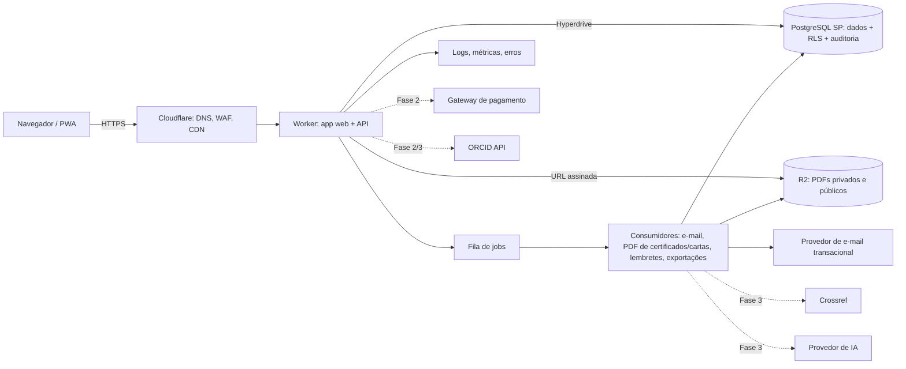
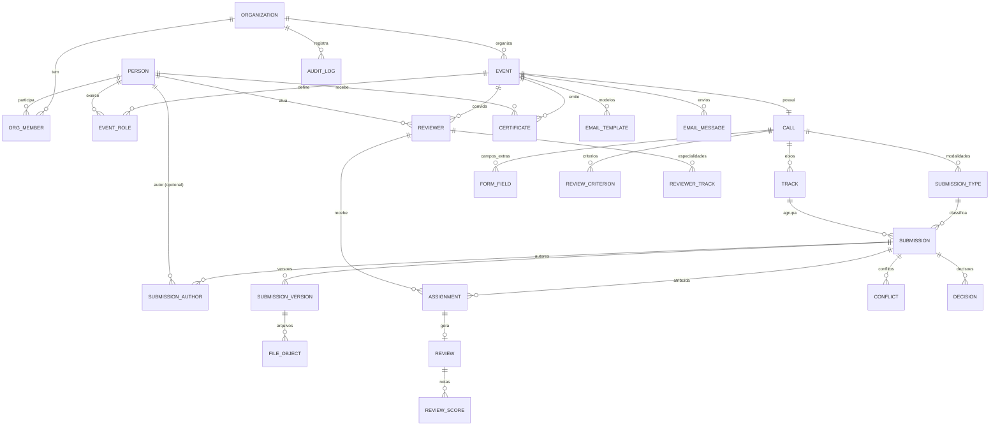

# 7. Arquitetura técnica e modelo de dados

## 7.1 Princípios

1. **Monólito modular** em uma linguagem (TypeScript). Microsserviços não se justificam para o volume previsto. **[HIPÓTESE]** Mesmo a Galoá, líder entre sociedades, declara ~200 mil trabalhos/ano: ordem de grandeza que um PostgreSQL pequeno atende com folga.
2. **Tecnologia substituível:** PostgreSQL padrão, armazenamento compatível com S3, e-mail via provedor com API simples. Nenhuma peça que não possa ser trocada em semanas.
3. **Custo proporcional ao uso** no início; nada pago por instância ociosa sem necessidade.
4. **Segurança por padrão:** isolamento de tenant no banco, arquivos privados, auditoria.

## 7.2 Opções avaliadas

Os preços abaixo vêm de conhecimento prévio da equipe e **precisam ser conferidos nas páginas oficiais antes da decisão final**.

| Critério | A. Tudo Cloudflare (Workers + D1 + R2) | **B. Workers + PostgreSQL gerenciado + R2** | C. Container (Fly/Render/Railway) + PostgreSQL + R2/S3 |
|---|---|---|---|
| Custo inicial | Muito baixo (~US$ 5/mês) | Baixo (~US$ 5 + US$ 0 a 25/mês de banco) | Baixo a médio (~US$ 10 a 40/mês) |
| Banco | SQLite distribuído; limite de tamanho por banco (10 GB no plano pago, conferir); sem RLS; migrações e ferramentas limitadas | PostgreSQL completo: transações, RLS, busca textual em português, extensões, `pg_dump` | Igual a B |
| Multi-tenant | Coluna `org_id` com disciplina na aplicação ou um banco por tenant (complexo de operar) | Coluna `org_id` + Row Level Security | Igual a B |
| Latência ao banco | Baixa | Workers chegam ao Postgres via Hyperdrive (pool + cache); banco em São Paulo | Baixa se app e banco na mesma região |
| Aprisionamento | Alto (APIs proprietárias D1/KV/Queues) | Médio (runtime Workers); dados portáveis | Baixo |
| Tarefas longas (PDF em lote, ZIP de anais) | Limites de CPU por requisição; exige Queues/Workflows | Igual a A para o código no Worker | Sem limite prático |
| Operação | Mínima | Mínima | Baixa |
| Ecossistema de bibliotecas Node | Parcial (compatibilidade Node melhorou, mas nem tudo roda) | Parcial | Completo |

### Recomendação **[RECOMENDAÇÃO]**: Opção B, com saída fácil para C

- **Cloudflare Workers** para a aplicação web e API (barato, sem servidor ocioso, CDN e proteção DDoS incluídas).
- **PostgreSQL gerenciado em região São Paulo** (Supabase, Neon ou equivalente que ofereça a região; conferir) acessado via **Hyperdrive**.
- **R2** para arquivos: sem custo de saída de dados, bom para downloads de PDFs e anais.
- **Cloudflare Queues** (ou tabela de jobs no Postgres) para e-mails, PDFs e lembretes.
- Código escrito com framework que roda em Workers **e** em Node (por exemplo Hono ou SvelteKit/Remix com adaptador), para migrar para C se aparecer limite de runtime.

**Por que não D1 no núcleo:** o núcleo é relacional e transacional (atribuições, decisões, conflitos, auditoria), exige isolamento forte entre clientes e busca textual decente para anais. PostgreSQL entrega isso de forma madura e portátil. D1 pode ser útil para cache ou dados de borda, não como fonte da verdade. Detalhes em [ADR 0002](adr/0002-banco-de-dados.md).

**PWA antes de app nativo:** sim. A página pública e a área do autor/participante funcionam como PWA instalável na Fase 3. App nativo só se houver demanda por recursos indisponíveis na web (não identificado).

## 7.3 Visão de componentes

## 7.4 Módulos

| Módulo | Responsabilidade |
|---|---|
| `identity` | Pessoas, sessões, link mágico, ORCID |
| `tenancy` | Organizações, membros, papéis, planos |
| `events` | Eventos, modelos, clonagem, páginas públicas, identidade visual |
| `calls` | Chamadas, modalidades, eixos, prazos, formulários |
| `submissions` | Submissões, autores, versões, arquivos, checagem formal |
| `review` | Avaliadores, convites, atribuição, conflitos, pareceres, rodadas |
| `decisions` | Decisões, liberação de resultados, cartas |
| `certificates` | Modelos, emissão, validação pública |
| `comms` | Modelos de e-mail, envios, lembretes, histórico |
| `audit` | Trilha imutável de ações sensíveis |
| `exports` | CSV/XLSX, exportação completa por evento |
| `admin` | Backoffice da plataforma |

## 7.5 Autenticação e autorização

- Identidade global (`person`) e papéis por contexto: `org_role` (owner, admin, member) e `event_role` (organizer, chair, track_chair, reviewer).
- Autor não é papel: decorre de ser autor de uma submissão.
- Autorização em duas camadas: checagem na aplicação (políticas por rota) **e** RLS no Postgres com `org_id` da sessão (defesa em profundidade).
- Duplo-cego aplicado na camada de serialização: o avaliador recebe DTOs sem campos de autoria; arquivos servidos são a versão anonimizada enviada pelo autor.
- Personificação pelo admin exige motivo e fica registrada.

## 7.6 Arquivos e documentos inéditos

- Bucket privado no R2; chave de objeto aleatória (`org/<org_id>/sub/<uuid>/<versao>.pdf`), sem nome do autor.
- Download só após checagem de permissão, com URL assinada de até 10 minutos e registro na auditoria.
- Remoção de metadados de autoria do PDF ao receber (ou alerta, se a remoção falhar).
- Varredura antivírus/validação de tipo real do arquivo (assinatura, não extensão).
- Arquivos públicos (anais) em prefixo separado com cache CDN.

## 7.7 Observabilidade, backup e recuperação

- Logs estruturados com `request_id`, `org_id`, `event_id`; erros em Sentry (ou similar); métricas de fila e e-mail.
- Backup: PITR do provedor de Postgres + `pg_dump` diário para bucket em **outro provedor** (evita depender de um único fornecedor). Versionamento de objetos no R2 + cópia semanal externa.
- Exercício de restauração documentado antes do piloto.
- Plano de saída: dados em Postgres padrão e arquivos via API S3. Migrar de Workers para container é troca de adaptador do framework.

## 7.8 LGPD e retenção

- **Papéis:** o organizador do evento é controlador dos dados dos participantes; a Cienvia é operadora. Contrato (DPA) padrão com cada organização. **[RECOMENDAÇÃO]** validar com advogado.
- Dados mínimos: nome, e-mail, instituição; CPF **não** é coletado no MVP (só seria necessário para certificados com exigência formal ou pagamentos).
- Política de retenção configurável por evento; padrão: arquivos de submissões rejeitadas e retiradas apagados 24 meses após o evento; pareceres anonimizados após o mesmo prazo.
- Direitos do titular: exportar e excluir dados pessoais pela própria conta; exclusão preserva registros científicos publicados (base legal de interesse legítimo/pesquisa, com anonimização quando possível).
- Hospedagem de dados no Brasil (região São Paulo) reduz atrito em vendas para instituições públicas. **[HIPÓTESE]** Não é exigência legal da LGPD, mas aparece em editais.
- IA (Fase 3): nenhum texto inédito enviado a provedor que retenha ou treine com dados; opt-in por evento.

## 7.9 Modelo de dados (núcleo do MVP)

### Tabelas e campos principais

| Tabela | Campos-chave |
|---|---|
| `organization` | id, name, slug, plan, created_at |
| `person` | id, email (único), name, affiliation, country, orcid_id, orcid_verified, lattes_url, interests[] |
| `org_member` | org_id, person_id, role |
| `event` | id, org_id, slug, title, edition, cloned_from_event_id, format (presencial/online/híbrido), starts_at, ends_at, timezone, branding (json), status, retention_months |
| `event_role` | event_id, person_id, role (organizer, chair, track_chair), track_id nullable |
| `call` | id, event_id, opens_at, closes_at, review_mode (single/double), reviews_per_submission, max_submissions_per_author, correction_deadline, results_released_at |
| `track` | id, call_id, name, description |
| `submission_type` | id, call_id, name, max_pages, max_mb, accepted_formats[] |
| `form_field` | id, call_id, key, label, type, required, options (json) |
| `submission` | id, org_id, event_id, track_id, type_id, code (ex.: MIC26-0042), title, abstract, keywords[], extra (json), status, submitted_at, withdrawn_at, publish_consent |
| `submission_author` | submission_id, position, person_id nullable, name, email, affiliation, is_corresponding, is_presenter |
| `submission_version` | id, submission_id, number, created_at, created_by, reason (initial/correction/final) |
| `file_object` | id, org_id, version_id, kind (anonymized/full/final), storage_key, mime, bytes, sha256, pages, check_report (json) |
| `reviewer` | id, event_id, person_id, status (invited/accepted/declined), max_load, invited_at |
| `reviewer_track` | reviewer_id, track_id |
| `assignment` | id, submission_id, reviewer_id, round, due_at, status (pending/declined_conflict/done/revoked), assigned_by |
| `review` | id, assignment_id, recommendation, comment_to_author, comment_to_committee, submitted_at |
| `review_criterion` / `review_score` | critério (nome, peso, escala) / nota por critério |
| `conflict` | submission_id, person_id, source (declared/rule_coauthor/rule_institution/manual), note |
| `decision` | id, submission_id, round, outcome (accepted/accepted_with_corrections/rejected/desk_rejected), decided_by, decided_at, released_at |
| `certificate` | id, event_id, person_id, kind (author/reviewer/...), subject_id, verification_code (único), issued_at, revoked_at, pdf_key |
| `email_template` / `email_message` | modelo por evento e tipo / envio, destinatário, status do provedor, erro |
| `audit_log` | id, org_id, actor_id, action, entity, entity_id, data (json), ip, created_at (append-only) |

**Decisões de modelagem:**
- `org_id` desnormalizado nas tabelas sensíveis para RLS eficiente.
- Coautor sem conta é armazenado no próprio `submission_author`; vínculo com `person` ocorre quando ele entra com o mesmo e-mail.
- Estados como enum + tabela de transições auditada; nunca apagar decisões, apenas registrar nova.
- Campos configuráveis em `jsonb` validados por esquema da chamada, para não criar EAV complexo.

## 7.10 Integrações

| Integração | Viabilidade | Fase |
|---|---|---|
| E-mail transacional (Postmark, Amazon SES, Resend) | Alta, barata | M |
| ORCID (API pública, OAuth `/authenticate`) | **[FATO conhecido]** Gratuita para obter iD autenticado; escrita no registro exige API de membro (paga) | E |
| Lattes | **[FATO]** Sem API pública; Extrator Lattes exige convênio institucional com o CNPq; raspagem é frágil e arriscada juridicamente | Só link |
| Pagamentos (Pix, cartão, boleto) via Asaas, Pagar.me, Mercado Pago, Stripe | Alta; exige cuidado com split, estorno e nota fiscal | E |
| Crossref (DOI) | Exige ser membro (anuidade a partir de US$ 200 para baixo recurso) ou sponsor; US$ 1,00 por conference paper | D |
| OpenAlex (coautoria pública para conflitos e similaridade) | API aberta e gratuita | D |
| Google Scholar | Sem API; indexação via metadados Highwire nas páginas dos anais | E |
